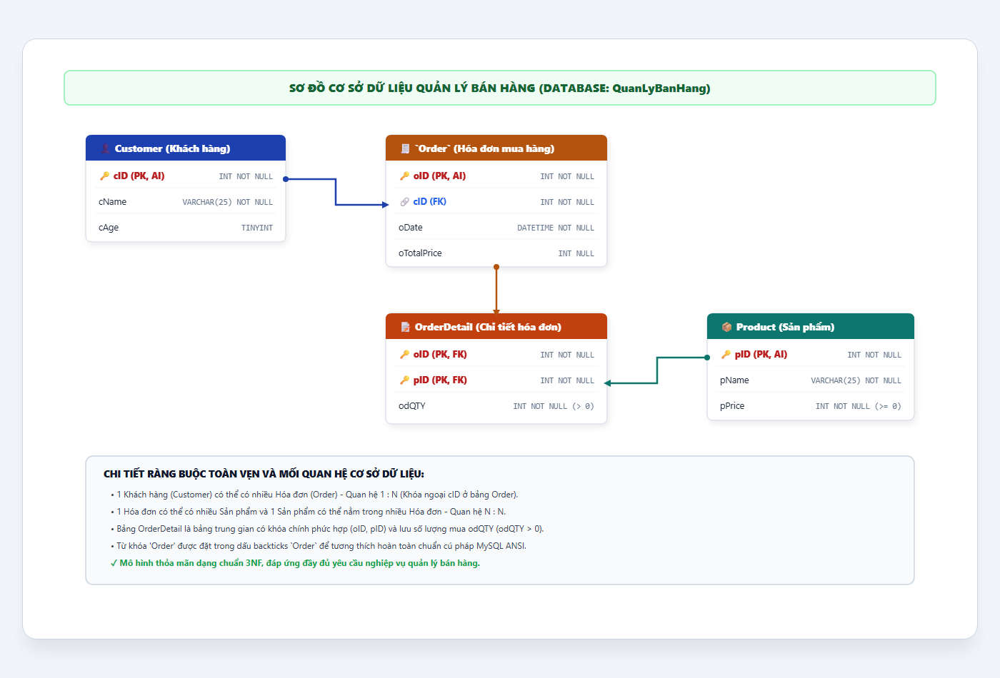

# [BÀI TẬP] XÂY DỰNG CƠ SỞ DỮ LIỆU QUẢN LÝ BÁN HÀNG (QuanLyBanHang)

- **Mục tiêu:** Tạo được cơ sở dữ liệu và các bảng với đầy đủ khóa chính (PK), khóa ngoại (FK) và các ràng buộc toàn vẹn dữ liệu cho hệ thống bán hàng siêu thị.
- **Tên CSDL:** `QuanLyBanHang`
- **Sinh viên thực hiện:** DTC245200413 (`dtc245200413-cmyk`)
- **Repository:** [https://github.com/dtc245200413-cmyk/jwbd-2023-sql-sales-management](https://github.com/dtc245200413-cmyk/jwbd-2023-sql-sales-management)

---

## 1. MÔ TẢ BÀI TOÁN & CÁC BẢNG TRONG CƠ SỞ DỮ LIỆU

* Bảng **`Customer`**: Lưu danh sách những khách hàng đã đến cửa hàng (gồm cả những người có mua hàng và cả những người không mua hàng).
* Bảng **`Order`**: Lưu thông tin hóa đơn khi khách hàng mua hàng gồm mã khách (`cID`), số hóa đơn (`oID`), ngày mua (`oDate`), tổng tiền (`oTotalPrice`).
* Bảng **`Product`**: Lưu danh mục sản phẩm, giá tiền của từng sản phẩm.
* Bảng **`OrderDetail`**: Lưu danh sách các sản phẩm được mua trong mỗi hóa đơn và số lượng của mỗi loại (`odQTY`).

### Cấu trúc chi tiết các bảng:

### Bảng 1: `Customer`
| STT | Tên trường | Kiểu dữ liệu | Độ dài | Ràng buộc | Ý nghĩa |
|:---:|:---|:---|:---:|:---|:---|
| 1 | `cID` | INT | | NOT NULL, PRIMARY KEY, AUTO_INCREMENT | Mã định danh khách hàng |
| 2 | `cName` | VARCHAR | 25 | NOT NULL | Tên khách hàng |
| 3 | `cAge` | TINYINT | | CHECK `cAge > 0` | Tuổi khách hàng |

### Bảng 2: `Order` *(Hóa đơn mua hàng)*
| STT | Tên trường | Kiểu dữ liệu | Độ dài | Ràng buộc | Ý nghĩa |
|:---:|:---|:---|:---:|:---|:---|
| 1 | `oID` | INT | | NOT NULL, PRIMARY KEY, AUTO_INCREMENT | Số hóa đơn (Mã đơn hàng) |
| 2 | `cID` | INT | | NOT NULL, FOREIGN KEY tham chiếu `Customer(cID)` | Mã khách hàng mua |
| 3 | `oDate` | DATETIME | | NOT NULL | Ngày mua hàng |
| 4 | `oTotalPrice` | INT | | NULL (Cập nhật sau khi tính tiền) | Tổng tiền hóa đơn |

### Bảng 3: `Product` *(Sản phẩm)*
| STT | Tên trường | Kiểu dữ liệu | Độ dài | Ràng buộc | Ý nghĩa |
|:---:|:---|:---|:---:|:---|:---|
| 1 | `pID` | INT | | NOT NULL, PRIMARY KEY, AUTO_INCREMENT | Mã sản phẩm |
| 2 | `pName` | VARCHAR | 25 | NOT NULL | Tên sản phẩm |
| 3 | `pPrice` | INT | | NOT NULL, CHECK `pPrice >= 0` | Đơn giá sản phẩm |

### Bảng 4: `OrderDetail` *(Chi tiết hóa đơn - Bảng trung gian quan hệ N - N)*
| STT | Tên trường | Kiểu dữ liệu | Độ dài | Ràng buộc | Ý nghĩa |
|:---:|:---|:---|:---:|:---|:---|
| 1 | `oID` | INT | | NOT NULL, PK, FK tham chiếu `Order(oID)` | Số hóa đơn |
| 2 | `pID` | INT | | NOT NULL, PK, FK tham chiếu `Product(pID)` | Mã sản phẩm |
| 3 | `odQTY` | INT | | NOT NULL, CHECK `odQTY > 0` | Số lượng mua |

---

## 2. SƠ ĐỒ MÔ HÌNH THỰC THỂ QUAN HỆ (ERD DIAGRAM)



### Sơ đồ dạng Mermaid:
```mermaid
erDiagram
    Customer ||--o{ Order : "mua hang (1:N)"
    Order ||--o{ OrderDetail : "chua chi tiet (1:N)"
    Product ||--o{ OrderDetail : "duoc ban (1:N)"

    Customer {
        int cID PK,AI "Mã khách hàng"
        string cName "Tên khách hàng"
        tinyint cAge "Tuổi"
    }

    Order {
        int oID PK,AI "Số hóa đơn"
        int cID FK "Mã khách"
        datetime oDate "Ngày mua"
        int oTotalPrice "Tổng giá tiền"
    }

    Product {
        int pID PK,AI "Mã sản phẩm"
        string pName "Tên sản phẩm"
        int pPrice "Giá tiền"
    }

    OrderDetail {
        int oID PK,FK "Số hóa đơn"
        int pID PK,FK "Mã sản phẩm"
        int odQTY "Số lượng mua (>0)"
    }
```

---

## 3. CÂU LỆNH SQL TẠO CSDL VÀ CÁC BẢNG

```sql
-- 1. Tạo cơ sở dữ liệu QuanLyBanHang
CREATE DATABASE IF NOT EXISTS QuanLyBanHang CHARACTER SET utf8mb4 COLLATE utf8mb4_unicode_ci;
USE QuanLyBanHang;

-- 2. Tạo bảng Customer
CREATE TABLE Customer (
    cID   INT         NOT NULL AUTO_INCREMENT PRIMARY KEY,
    cName VARCHAR(25) NOT NULL,
    cAge  TINYINT     NULL CHECK (cAge > 0)
);

-- 3. Tạo bảng Order (đặt trong dấu backticks `Order` vì trùng từ khóa SQL)
CREATE TABLE `Order` (
    oID         INT      NOT NULL AUTO_INCREMENT PRIMARY KEY,
    cID         INT      NOT NULL,
    oDate       DATETIME NOT NULL,
    oTotalPrice INT      NULL CHECK (oTotalPrice >= 0),
    FOREIGN KEY (cID) REFERENCES Customer (cID)
);

-- 4. Tạo bảng Product
CREATE TABLE Product (
    pID    INT         NOT NULL AUTO_INCREMENT PRIMARY KEY,
    pName  VARCHAR(25) NOT NULL,
    pPrice INT         NOT NULL CHECK (pPrice >= 0)
);

-- 5. Tạo bảng OrderDetail
CREATE TABLE OrderDetail (
    oID   INT NOT NULL,
    pID   INT NOT NULL,
    odQTY INT NOT NULL CHECK (odQTY > 0),
    PRIMARY KEY (oID, pID),
    FOREIGN KEY (oID) REFERENCES `Order` (oID),
    FOREIGN KEY (pID) REFERENCES Product (pID)
);
```

---

## 4. TỆP MÃ NGUỒN SQL HOÀN CHỈNH
Mã nguồn đầy đủ gồm câu lệnh DDL tạo bảng, dữ liệu mẫu kiểm chứng (`INSERT INTO`) và câu truy vấn kiểm thử có sẵn tại:
👉 [`QuanLyBanHang.sql`](QuanLyBanHang.sql)

---

## 5. LINK NỘP BÀI
- **GitHub Repository:** [https://github.com/dtc245200413-cmyk/jwbd-2023-sql-sales-management](https://github.com/dtc245200413-cmyk/jwbd-2023-sql-sales-management)
